# WindowTuner

### Make every window behave the way you want.

WindowTuner is a desktop app for building, previewing, and safely managing
[Hyprland](https://hyprland.org/) window rules. Pick a window, choose how it
looks and where it opens, review the change, then apply it—without hand-writing
Lua.

<p align="center">
  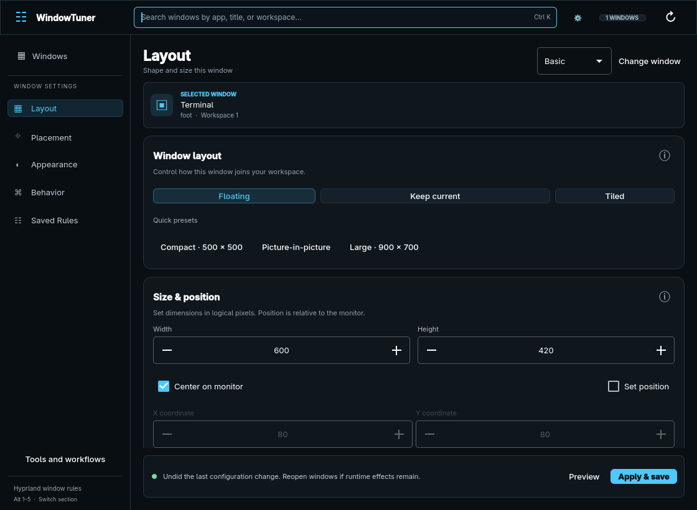
</p>

<p align="center">
  <strong>Shape windows · place apps · keep changes reversible</strong>
</p>

> **Download:** [Get WindowTuner 1.0.0 for Linux (x86_64 AppImage)](https://github.com/TowhidMolla-Dev/WIndowTuner/releases/latest).
> The AppImage bundles Qt. A running Hyprland session and `hyprctl` must still
> be available on your system.

---

## Get started

### Run the AppImage

Download `WindowTuner-1.0.0-x86_64.AppImage` from
[GitHub Releases](https://github.com/TowhidMolla-Dev/WIndowTuner/releases/latest),
then run:

```sh
chmod +x WindowTuner-1.0.0-x86_64.AppImage
./WindowTuner-1.0.0-x86_64.AppImage
```

Check the adjacent `.sha256` file if you want to verify the download.

### What you need

- Linux running a Hyprland session, with `hyprctl` available on `PATH`.
- A Hyprland configuration entry point written in Lua and using Hyprland's Lua
  API. WindowTuner does not generate legacy `.conf` rules.
- To build from source: Qt 6 development packages (Quick, QML, Quick Controls),
  `qmake6`, a C++17 compiler, and `make`.

### Build and install from source

```sh
git clone https://github.com/TowhidMolla-Dev/WIndowTuner.git
cd WIndowTuner
./bin/build
./bin/install
```

Launch from your application menu, or run:

```sh
windowtuner
```

The installer places the app in `~/.local/bin` and adds a desktop launcher and
icon under `~/.local/share`. Make sure `~/.local/bin` is on your `PATH`.

### Your first rule

1. Select a window from **Windows**, or use the crosshair to pick one on screen.
2. Choose a section: **Layout**, **Placement**, **Appearance**, or **Behavior**.
3. Use **Preview** to check the result, then **Apply & save** to review the
   generated change and apply it.

The review dialog shows what will change. Save is enabled only when the
installed Hyprland parser accepts the generated configuration.

---

## Shape and place windows

Tune floating or tiled behavior, size, position, centering, workspace, opacity,
borders, rounding, blur, shadow, focus, animations, dimming, VRR, and persistent
floating size. Use the placement designer for anchors, margins, percentage-based
sizing, and aspect-ratio locking.

WindowTuner can also help with the rest of the workflow:

- **Find a target:** search open windows by app, title, or workspace, or use the
  on-screen picker.
- **Know what a rule matches:** inspect the selected window against your draft
  and saved WindowTuner rules before applying.
- **Reuse settings:** save presets, organize rules into collections, and
  preview a profile before activating it.
- **Start from an app:** create an offline target from desktop-entry hints when
  the app is not open.

## Feature tour

### Shape and position windows

Set floating or tiled layout, size, position, centering, and placement anchors.
The visual designer previews geometry against a selected display and supports
percentage sizing and aspect-ratio locking.

<p align="center">
  
  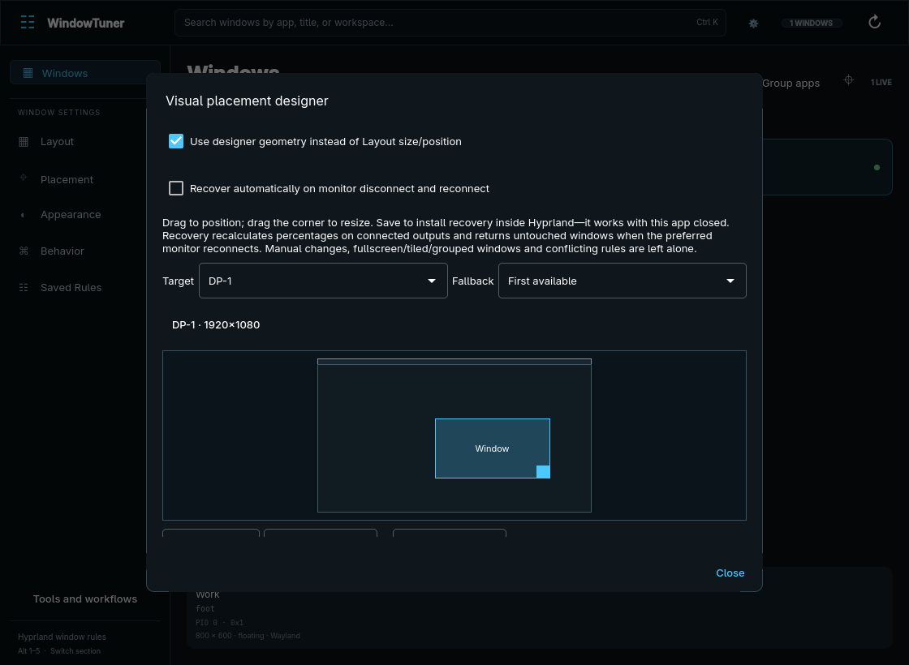
</p>

### Inspect and organize rules

Check whether a draft matches open windows, inspect the selected window's live
properties, organize rules into collections, and import or export selected
rules.

<p align="center">
  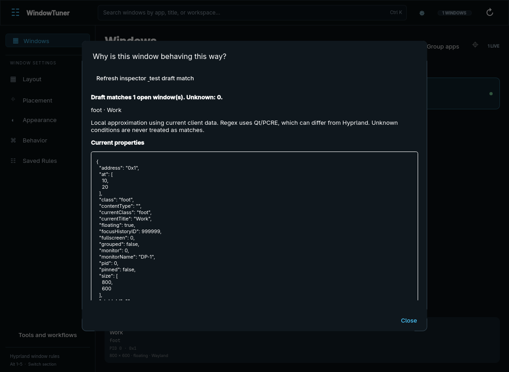
  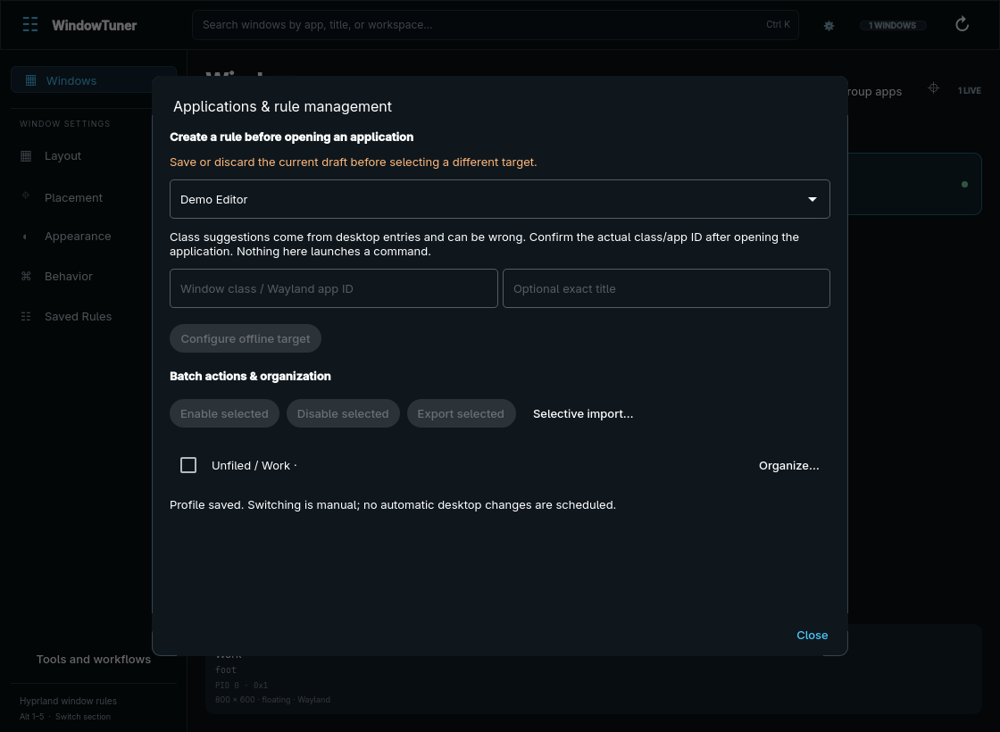
</p>

### Map desktops and restore scenes

The Desktops overview shows connected displays, active workspaces, open apps,
and placement rules without moving anything. Saved scenes capture app classes
and relative window geometry. Optional session snapshots are off by default;
when enabled, they are debounced, retained locally, and restored only after
preview and confirmation. Neither workflow launches missing apps.

<p align="center">
  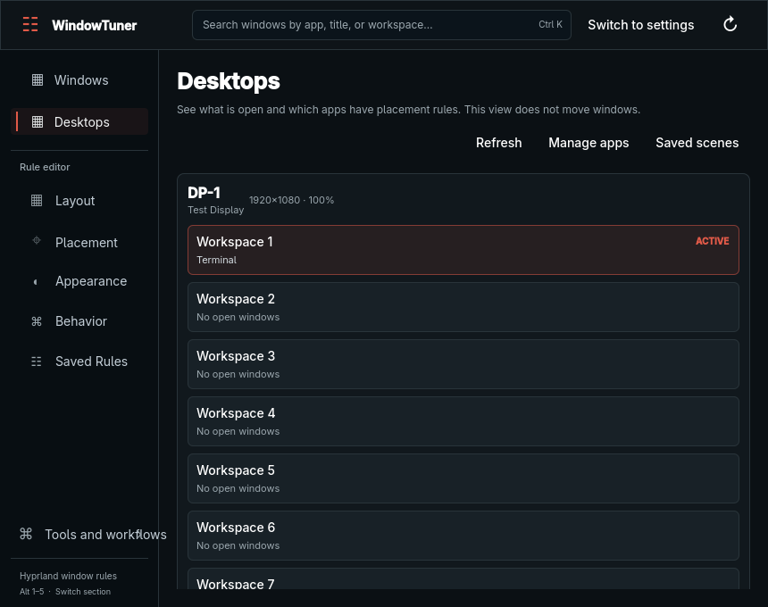
  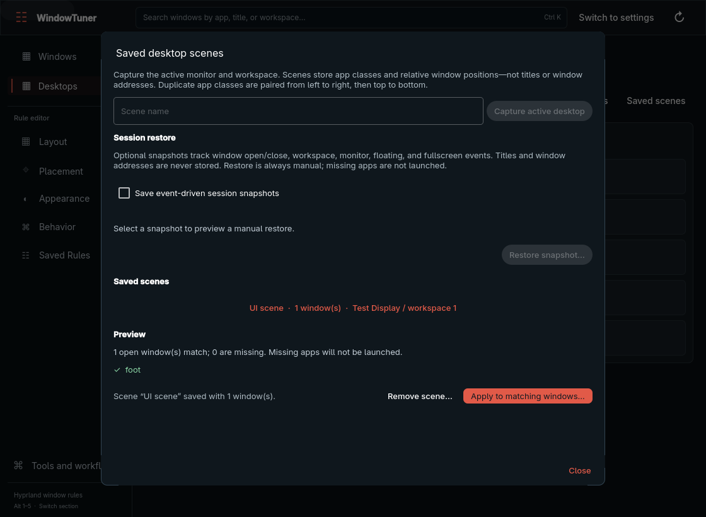
</p>

### Apps, workspaces, and displays

The **Desktops** page in the main window shows connected monitors and workspaces,
including open windows, active workspaces, and saved placement rules. The
overview is read-only. **Saved scenes** can capture the active desktop, preview
which saved app classes are currently open, and—after confirmation—restore the
matching windows' workspace and layout. Missing apps are reported, not
launched. Scene files store app classes and relative geometry, not window
titles or addresses; the saved monitor must still be connected.

In **Saved scenes**, session snapshots are optional and disabled by default.
When enabled, WindowTuner listens to Hyprland window/workspace/monitor events
and saves debounced snapshots locally (up to 10). You can preview and manually
restore a snapshot across displays and workspaces. Automatic restore at login
is not provided; restore never launches missing applications.

The **Apps, workspaces, displays** tool brings app placement into one place:

- Find running, pinned, and installed apps in a searchable, filterable list.
  Select one to set its workspace, open quietly, launch at login, or limit its
  workspace placement to windows opened during a startup time window.
- Pin workspaces to a display, mark them always present, and see which apps are
  assigned to each workspace.
- Edit connected displays' mode, position, scale, and rotation. A changed
  layout reverts after 15 seconds unless you keep it; leave WindowTuner open
  while deciding.
- Preview and import AppSpace rules, workspace pins, aliases, and display
  layouts into WindowTuner's own files.

This does not edit AppSpace's files. After importing, disable AppSpace or remove
its generated module to avoid two tools placing the same apps. WindowTuner does
not include AppSpace's bar widget/workspace strip or its drag-and-drop display
canvas. App classes derived from desktop entries are hints; a running window's
reported class is authoritative.

Open **Tools and workflows** for safety, placement, inspection, presets,
application management, compatibility checks, and the guided walkthrough.

### Safety, compatibility, and reusable workflows

Review changes before saving, validate generated configuration with the
installed Hyprland parser, undo or redo configuration edits, and try geometry
with a timed revert. Health diagnostics and capability audits help explain
what the current compositor supports. Presets and profiles are applied
manually; they do not launch apps or change the desktop automatically.

<p align="center">
  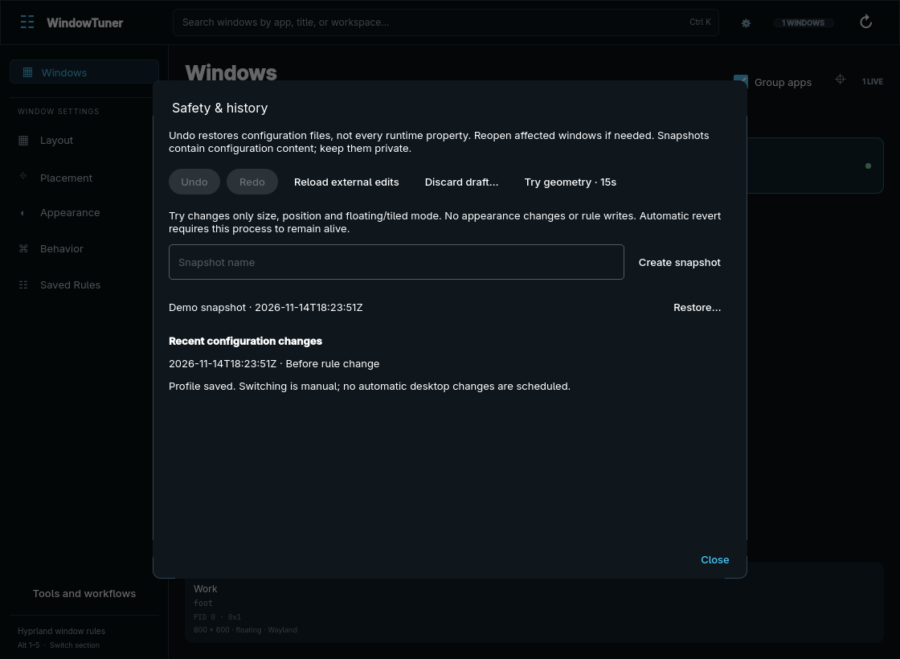
  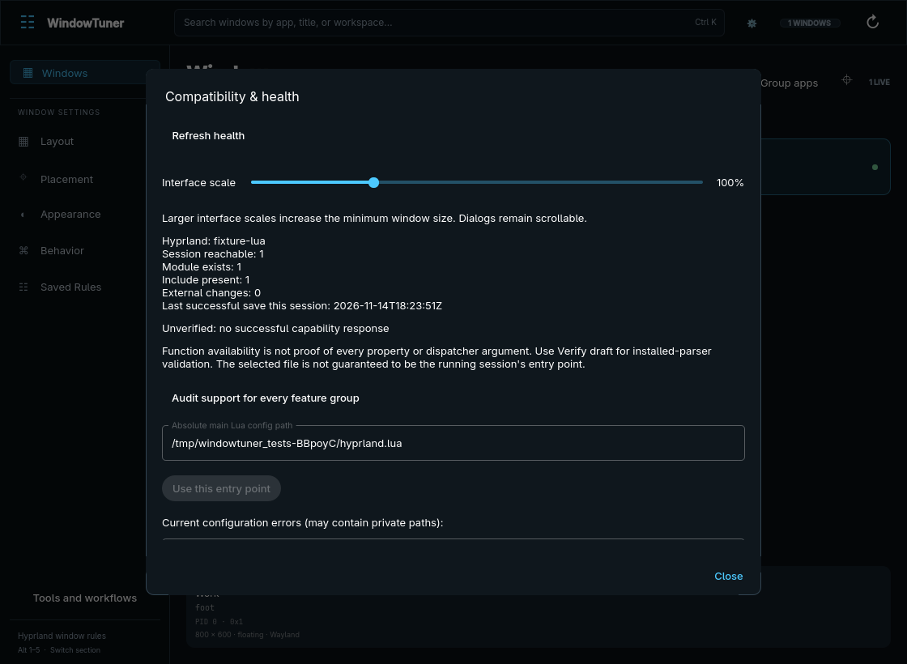
</p>
<p align="center">
  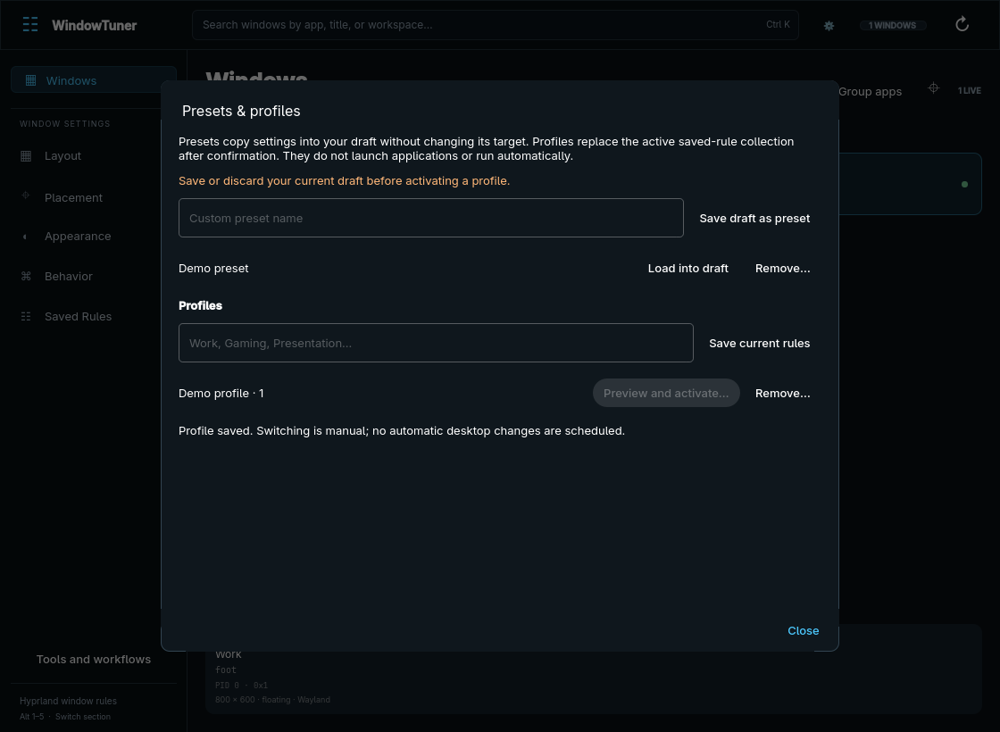
  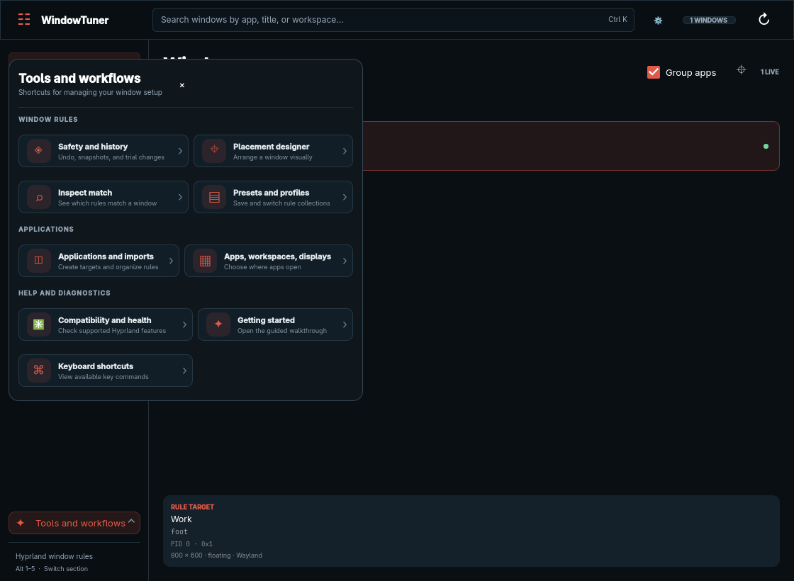
</p>
<p align="center">
  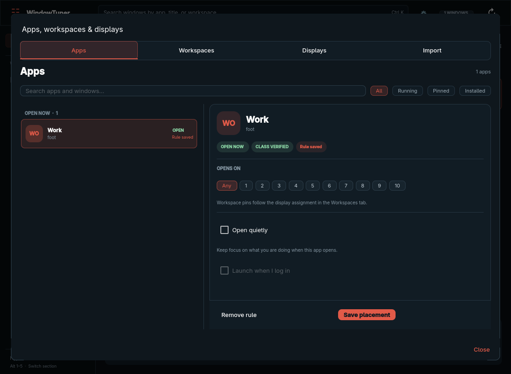
</p>

---

## Built to be reversible

WindowTuner treats changing compositor configuration as something you should be
able to inspect and undo:

- **Review before saving.** See the generated module and main-config changes
  before they are written.
- **Validate with Hyprland.** Drafts are checked with the installed parser;
  config errors introduced by a change trigger rollback.
- **Recover changes.** Undo/redo, named snapshots, atomic writes, a first-edit
  backup, and external-edit detection are built in.
- **Try geometry temporarily.** A 15-second trial changes only the selected
  window's geometry and can be reverted without saving a rule.
- **Keep recovery scoped.** Opt-in monitor recovery repositions eligible windows
  after a display disconnect/reconnect while WindowTuner is closed. It avoids
  windows that appear fullscreen, tiled, hidden, grouped, conflicting, or
  manually moved.

A parser accepting Lua does not guarantee that every property behaves the same
on every Hyprland version or application. Review the preview and compatibility
audit, especially before using unfamiliar properties.

---

## Keyboard shortcuts

| Shortcut | Action |
| --- | --- |
| `Alt+1`–`Alt+5` | Switch between editor sections |
| `Ctrl+F` or `Ctrl+K` | Focus search |
| `Ctrl+R` | Refresh open windows |
| `Ctrl+S` | Review a new rule or update |
| `Ctrl+Z` / `Ctrl+Shift+Z` | Undo / redo when the draft is clean |
| `Ctrl+Q` | Quit, with an unsaved-draft warning |
| `?` | Open the shortcut reference |
| `Escape` | Cancel editing or dismiss the screen picker |

---

## Configuration and privacy

WindowTuner expects `~/.config/hypr/hyprland.lua` by default. Choose another
Lua entry point in **Compatibility and health** if your setup uses one. Confirm
that your running Hyprland session actually loads that entry point.

| File | Purpose |
| --- | --- |
| `~/.config/hypr/windowtuner.json` | Saved rules |
| `~/.config/hypr/windowtuner.lua` | Generated Hyprland Lua module |
| `~/.config/hypr/windowtuner-library.json` | Presets, profiles, preferences, workspace pins, and display layouts |
| `~/.config/hypr/windowtuner-history.json` | Local configuration history and snapshots |
| `~/.config/hypr/hyprland.lua.windowtuner.bak` | First-edit backup of the main config |

These files stay local. Diagnostics omit window titles, classes, paths, rule
bodies, raw compositor errors, and monitor identifiers. `inspect` and `export`
can include private local data—review their output before sharing it.

---

## Read-only command line

The CLI can check configuration and inspect or export local rules without
opening the GUI:

```sh
windowtuner check --json
windowtuner diagnostics --json
windowtuner inspect --json
windowtuner export --json
windowtuner verify --settings-file settings.json --json
```

`check` and `verify` return a nonzero exit code when a check fails. The CLI does
not mutate configuration.

---

## Build and test from source

```sh
./bin/build
./bin/test
lua tests/appspace.lua
lua tests/monitor_recovery.lua
python3 tests/cli_smoke.py
```

The GUI/backend suite runs against disposable configuration. `./bin/test-live`
is an optional test inside a Hyprland session: it creates and changes only its
own test window, and never writes rules or reloads Hyprland. It may skip if the
compositor reports that test window as fullscreen, because geometry then cannot
be observed safely.

---

## Known boundaries

- Legacy Hyprland `.conf` rule generation is not supported; WindowTuner targets
  Lua configuration and native `hl.*` APIs.
- Local regex inspection uses Qt/PCRE and approximates Hyprland's RE2 matching.
  Conflict detection is conservative, not a proof that arbitrary expressions
  overlap.
- Desktop-entry classes can differ from an app's actual Wayland app ID. Guesses
  are labelled, and WindowTuner does not launch apps just to verify a class.
- Monitor recovery does not switch profiles or survive a full Hyprland restart.
  Display-layout keep/revert needs WindowTuner to stay open; closing it before
  confirmation leaves the applied layout in place.
- AppSpace import does not disable the plugin for you. The bar widget,
  workspace strip, drag-and-drop display canvas, and app-launch class discovery
  are not included.

For detailed scope and verification evidence, see the
[implementation report](docs/one-stop-report.md).

## License

See [`LICENSE`](LICENSE).
