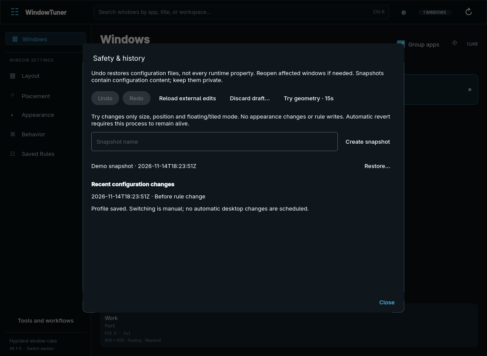
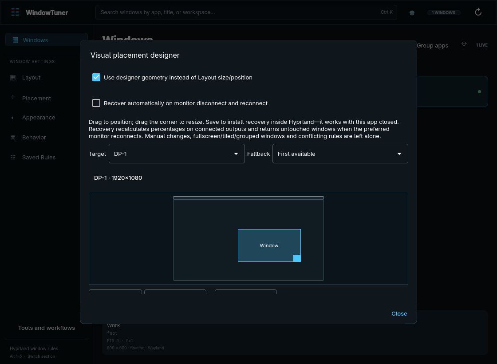
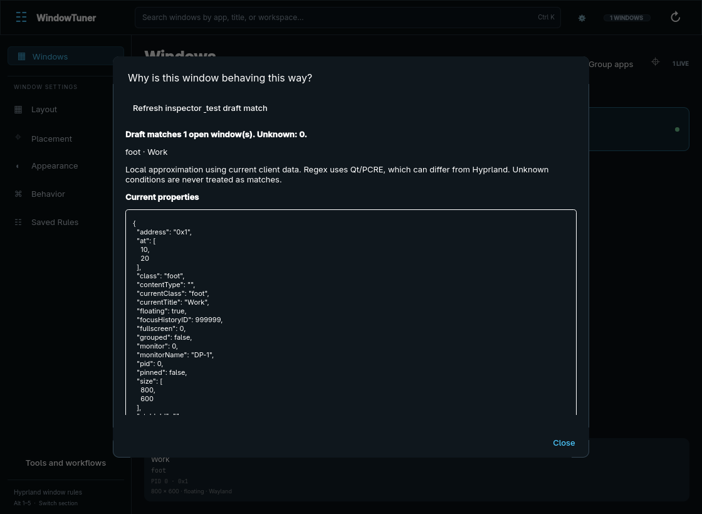
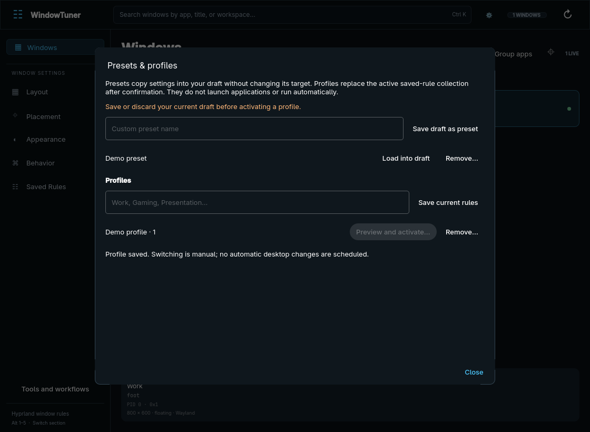
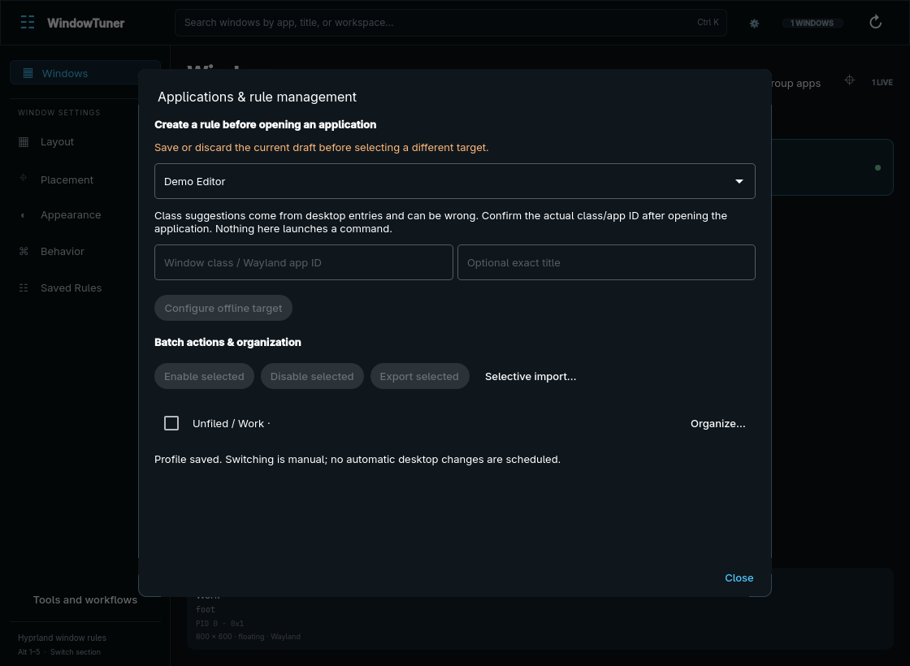
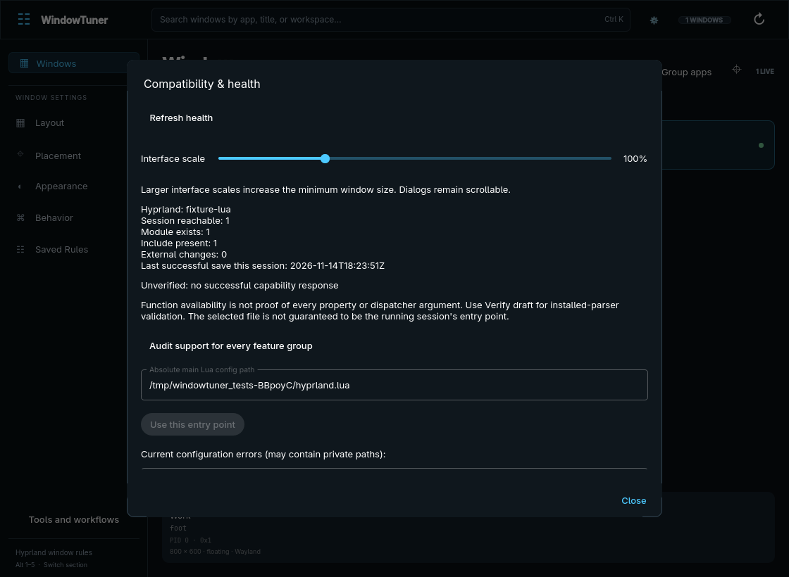

# WindowTuner one-stop implementation report

Date: 2026-11-15. Work started 2026-11-14.

## Outcome

Implemented the seven requested areas in sequence, with tests between stages.
The existing sidebar editor and eleven module-help buttons remain in place.
New tools are accessed through **Tools and workflows**.

The implementation has explicit boundaries: monitor placement is configured at
save time, an opted-in rule can re-place its window at runtime, profiles switch
manually, local rule inspection is approximate, and temporary trials change
geometry only. Those boundaries appear in the UI and are not presented as
complete compositor introspection or as unrequested background services.

## 1. Safety and recovery

- Apply/update opens a review dialog before changing configuration.
- The review includes a plain-language summary and before/after views of both
  the generated module and selected main configuration.
- A regression test compares reviewed content with the files actually written,
  including new rules, replacement saves, and updates.
- The installed Hyprland parser must accept the draft before Save is enabled.
- Persistent configuration undo/redo and a recent-history list survive restart.
- Named snapshots restore the rule JSON, generated Lua, and main Lua file
  together, with a confirmation explaining the replacement.
- Reload/config-error failures restore the previous configuration.
- External edits and concurrent writers are detected rather than overwritten.
- Corrupt or incomplete snapshots and malformed rule data are rejected.
- Dirty drafts are guarded on target changes, saved-rule loading, and quitting.
- A geometry-only trial reverts automatically, can be reverted manually, and
  retains its recovery record when reverting fails.

History normally retains 50 prior configuration states; named snapshots retain
30 entries. Snapshots do not recursively back up other required Lua modules.
Configuration undo does not necessarily reset existing live overrides.

## 2. Visual placement

- Monitor selection and a scaled monitor preview.
- Visible usable-area boundaries, including reserved panel space.
- Dragging and lower-right-handle resizing, exercised with real QML mouse events.
- Center, edge and corner anchors, custom positioning, and margins.
- Percentage or logical-pixel dimensions and aspect-ratio locking.
- Scale and rotation handling, geometry clamping, and selectable fallback.
- Designer settings round-trip through saved rules and presets.
- Opt-in runtime recovery: saved rules can re-place their window after monitor
  disconnect, reconnect and layout changes while WindowTuner is closed.
- Recovery uses the rule's native tag for exact matching, recalculates
  percentages for the connected output, restores untouched windows to the
  preferred monitor, and rolls back safely if a dispatcher fails.
- Recovery deliberately skips fullscreen, tiled/non-floating, hidden, grouped,
  conflicting and manually moved windows, and debounces event storms.

Percentages and fallback resolve when saving. Without runtime recovery,
reopen/resave after monitor changes. Runtime recovery runs inside the generated
module, not as a background daemon; it cannot survive a full Hyprland restart,
and it does not switch profiles. The preview shows the selected monitor; other
connected outputs are selectable.

## 3. Inspector and match testing

- Test the current draft against open windows before applying it.
- Inspect current window properties and matching enabled saved rules.
- Show each rule's requested settings and conflicting requested values.
- Unknown predicates are not treated as successful matches.
- Live saved-rule application uses the same complete available-condition
  evaluator rather than ignoring workspace/state conditions.
- Main-file hints identify possible external rules and includes without
  executing their contents or following the include graph.

Hyprland v0.56.2 uses RE2 full matching. Contains generation now emits explicit
wildcards, and local regex matching is anchored. Qt/PCRE still differs from
RE2; local inspection is not proof of arbitrary regex overlap or effective
compositor precedence.

## 4. Presets and profiles

- Save and reload named custom settings presets.
- Presets exclude target predicates so loading one does not silently broaden
  the current application's matching scope.
- Save named rule-collection profiles.
- Preview and confirm profile activation; successful activation is undoable.
- Confirm library-item deletion and reject ambiguous duplicate names.
- Persist profiles, presets and preferences in a private library file.

Profiles switch manually. No automatic profile switching on monitor events,
application launching, scheduling, cloud service, or background daemon is
installed; placement recovery (section 2) only re-places opted-in windows.
Library item deletion is not part of configuration undo history.

## 5. Applications and rule management

- Group open-window discovery by application.
- Choose an installed application's desktop-entry class hint, or enter a class
  manually, to configure an application that is not open.
- Edit class/title patterns and retain saved target predicates while editing
  offline rules.
- Track the edited rule by stable ID so reordering cannot update another rule;
  removal blocks accidental updates.
- Name rules, assign folders and comma-separated tags, and search that metadata.
- Enable/disable selected rules in one transaction and export selected records.
- Validate and preview imports, choose incoming records, and explicitly select
  merge or whole-collection replacement.
- Merge preserves existing records and assigns new IDs to colliding copies.
- Reject malformed imports, unsupported settings/predicates and stale selections.

Desktop-entry hints can differ from the actual Wayland app ID. Opening the app
and testing the match remains necessary. Folders are metadata/search organization,
not filesystem directories or a separate folder-tree browser.

## 6. Compatibility and health

- Running version, session reachability, selected configuration path, include
  presence, generated-module presence, external edits and last successful save.
- Configurable existing Lua entry point without assuming a require search path
  for new integrations.
- Read-only Lua function-availability probes.
- Isolated `Hyprland --verify-config` validation for drafts, including dispatcher
  constructors and the generated recovery runtime without dispatching anything.
- An on-demand ten-group audit distinguishes parser-accepted, rejected and
  unverified feature groups.
- Allowlisted diagnostics omit window titles, app classes, rule bodies, paths,
  raw compositor errors, environment variables and monitor identities.
- Read-only `check`, `diagnostics`, `inspect`, `verify` and `export` CLI commands
  emit JSON and can run without a display.

Generated rules now use native `hl.window_rule`, rather than depending on the
Omarchy-specific `o.window` helper. Existing integrations remain supported.
Parser acceptance and function presence are not proof of every application's
runtime behavior. Legacy hyprlang `.conf` generation is not implemented.

## 7. Beginner experience

- A four-step first-run walkthrough that can be reopened.
- Basic/Advanced modes; hidden advanced values are preserved, not silently reset.
- Clear application/title/advanced scope choices.
- Field-specific validation with invalid-save prevention.
- Plain-language summaries and the existing eleven hover/focus/click help buttons.
- Settings search with section navigation and advanced-setting reveal.
- Keyboard shortcuts for review/save, navigation, help, undo/redo and guarded quit.
- Adjustable interface scale, with matching minimum window dimensions.
- Consistent opaque, dark tool dialogs with bounded scroll content.

This is not a claim of a comprehensive assistive-technology audit or complete
translation coverage. Current Linux/Qt keyboard, focus, layout and tooltip paths
are exercised by the GUI suite.

## 8. Apps, workspaces and displays (AppSpace parity)

Added after the seven areas, from the `dominikzajac.appspace` plugin v0.6.2.
Scope is the plugin's app/workspace/monitor model, not its Omarchy bar widget.

- **Apps tab.** One searchable list merging running windows, saved rules and
  desktop entries. Class derivation follows AppSpace: declared
  `StartupWMClass`, then Steam ids, Omarchy TUI and web-app launchers, then the
  desktop-entry name. Derived classes are labelled *inferred*; a running window
  marks its class verified. Placement writes workspace, silent, launch-at-login
  and login-only placement into the existing rule model
  (`workspace`, `noInitialFocus`, `autostart`, `launchCommand`, `launchDesktop`,
  `startupOnly`, `startupWindow`), so it lands in the same validated module.
- **Workspaces tab.** Ten slots with a display pin, *always present*, assigned
  apps, and clear. Rules are native `hl.workspace_rule`. On Omarchy 4.5 the
  slot resolves through the monitor's block in
  `~/.local/state/omarchy/monitor-workspaces`, falling back to
  `o.workspaces.workspace_id`; a `hyprmoncfg` switch that disables per-monitor
  numbering is detected. Super+N, Super+Shift+N and Super+Shift+Alt+N are
  rebound per assigned slot and address the owning display. Generated window
  rules call `__windowtuner_ws(slot, "desc:...")` instead of hard-coding a
  number.
- **Displays tab.** Mode, X/Y, scale, rotation and enabled per connected
  monitor, saved by description. A change seeds every connected screen first,
  then applies; the previous layout is restored after 15 seconds unless kept,
  and a second change while waiting still reverts to the layout from before the
  first.
- **Import tab.** Reads AppSpace schema 6, previews added/updated rules plus
  workspace and display counts without writing, then imports rules, pins,
  aliases and layouts. Aliases are resolved before matching so a second import
  updates rather than duplicates. The dialog states plainly that AppSpace's own
  module must be removed afterwards.
- **Config-error baseline.** `configerrors` now records the errors that already
  exist before a change and rolls back only on *new* ones, so an unrelated
  broken file can no longer block a valid save. Two regression tests cover both
  halves: an existing error does not block, an introduced one does.

Runtime behavior lives in `src/appspace_runtime.lua`, embedded in the generated
module and installed before the window rules. It emits monitor and workspace
rules, rebinds keys, moves only login windows inside their window, and runs
autostart through `o.exec_on_start` on Omarchy or `hyprland.start` elsewhere.
`stop()` removes every subscription and rebind, and the module's cleanup block
calls it before reinstalling.

Deliberately not ported: the bar widget and workspace strip, launching apps to
verify their class, drag-and-drop monitor arrangement, and mutating CLI
commands.

## Verification

Test environment: Linux x86_64, Omarchy 4.5.0, Qt 6.12.0, Hyprland v0.56.2.

| Layer | Command | Result |
| --- | --- | --- |
| Backend and actual-QML suite | `WINDOWTUNER_TEST_SCREENSHOTS=/tmp/opencode/windowtuner-one-stop ./bin/test` | 40 passed, 0 failed, 0 skipped |
| Monitor-recovery scenarios (production Lua) | `lua tests/monitor_recovery.lua src/monitor_recovery.lua` | 15 scenarios passed |
| AppSpace runtime scenarios (production Lua) | `lua tests/appspace.lua src/appspace_runtime.lua` | 18 scenarios passed |
| Installed-parser feature audit | Included in the suite | All 10 groups accepted; full combined draft also accepted |
| Owned-window live geometry | `./bin/test-live` | 3 passed, 0 failed, 0 skipped |
| Read-only CLI fixture checks | `python3 tests/cli_smoke.py` | 9 checks passed; no configuration writes |
| Application compilation | `./bin/build` | Successful |
| Local installation | `./bin/install` | Successful; installed/build SHA-256 hashes match |
| Whitespace validation | `git diff --check` | No errors |

Qt Test totals include initialization/cleanup records and data-driven cases.
The live suite contains one functional test plus those two lifecycle records;
it is not three separate runtime-feature tests.

The AppSpace suite runs `src/appspace_runtime.lua` against a fake compositor and
temporary state/config roots: monitor rules by description, workspace pins,
default slot, block-file numbering, slot-API fallback, the `hyprmoncfg`
stand-down, `workspace_id`, both keybinding families, missing displays, the
startup window boundary, both autostart paths, and cleanup. The C++ suite covers
class derivation, import preview/idempotence with aliases, workspace pins in
generated rules, the display keep/revert sequence, autostart refusals, and
requires the installed Hyprland parser to accept the full generated module with
runtime, pins, startup and autostart data.

The recovery suite runs the production `src/monitor_recovery.lua` against a
fake compositor: scaled disconnect, reconnect, event storms, manual moves,
all-output outage, skipped window states, tag scoping, conflicting policies,
address reuse, dispatcher rollback, deterministic fallback, timer-less
operation and cleanup. The GUI suite also generates a real rule module with
recovery enabled and requires the installed Hyprland parser to accept it.

The GUI suite renders all seven tool dialogs at 860×680, 1120×820 and 1440×900,
switches every tab of the apps/workspaces/displays dialog, and renders the
editor and module-help tooltip. It asserts opaque dialog
backgrounds, bounded scroll widths, visible actions, hover/focus behavior,
search, onboarding, dirty guards, scaling and pointer interactions.

The offscreen platform prints two `propagateSizeHints()` warnings during the
scale test. The QML warning spies remain empty; tests pass. Screenshots use
fixture windows and an isolated desktop-entry inventory, not personal content.

The local AST knowledge graph was refreshed: 383 nodes and 881 edges.
Its extractor reports partial parsing for the Qt Test C++ files and does not
classify QML. Those are indexing limitations, not compiler failures; both C++
test executables compile and pass. No semantic extraction or API key was used.

The live test creates its own Qt window, identifies it by its process ID/title,
waits for a usable compositor snapshot, tries a 550×360 floating geometry,
verifies compositor-reported size, reverts the original layout mode and closes
the window. A short retry covers a transient first-map reporting race; twenty
consecutive local runs passed. It does not save rules, reload Hyprland, or
target existing user windows. Remaining persistence and failure tests use
disposable configuration and fake IPC responses.

### Regressions found and corrected

1. Ambient Wayland settings allowed the compositor to resize supposedly
   headless GUI tests. The launcher now defaults explicitly to offscreen.
2. New tool dialogs had transparent bodies and unbounded scroll content.
   Screenshot review found this; a shared dialog surface and viewport bounds
   now have regression assertions.
3. Standalone parser validation exposed dependence on `o.window`. Generation
   now uses native `hl.window_rule`.
4. Contains matching lacked wildcards for Hyprland's full-match semantics.
5. Live initial-focus handling used the stronger `no_focus` override. That
   incorrect live mapping was removed; initial focus remains creation-time.
6. Zero border width did not survive editor loading. Zero values now round-trip.
7. Saved-rule editing could lose target identity after reordering. Saves now
   resolve stable IDs and refuse updates to removed targets.
8. Creating a Hyprland timer while parsing a config crashed
   `Hyprland --verify-config` (exit 139). Recovery now records its baseline
   synchronously and creates the debounce timer lazily on the first runtime
   event, with a direct-reconcile fallback if timers are unavailable.

## Files and deployment

- Logic: `src/backend.cpp`, `src/safety.cpp`, `src/placement.cpp`,
  `src/inspector.cpp`, `src/workflows.cpp`, `src/management.cpp`,
  `src/appspace.cpp`, `src/health.cpp`.
- Runtime: `src/monitor_recovery.lua` and `src/appspace_runtime.lua`, compiled
  into the generated module when placement recovery or workspace/display data
  needs them.
- UI: `src/Main.qml` and the eight tool/dialog components, with
  `StudioDialog.qml` providing their shared surface.
- Verification: `tests/windowtuner_tests.cpp`, `tests/monitor_recovery.lua`,
  `tests/appspace.lua`, `tests/live_geometry.cpp`, `tests/cli_smoke.py`,
  `bin/test`, and `bin/test-live`.
- User documentation and fixture screenshots are updated.

Installation replaces the local application binary and launcher assets only;
existing real rules are not migrated or rewritten until the user saves in the
app. Source changes remain local and are not committed or pushed by this task.

## Remaining scope

No complete external-config parser, general regex-overlap solver, all-app
runtime certification, profile switching on monitor events, or guaranteed
recovery after a full compositor restart is claimed. Placement recovery covers
opted-in rules only and skips windows the user or another rule has changed.
AppSpace parity stops at its bar widget, class verification by launching apps,
drag-and-drop display arrangement and mutating CLI commands. Additional effects
and native window-group controls in `TODO.md` remain separate future work.
